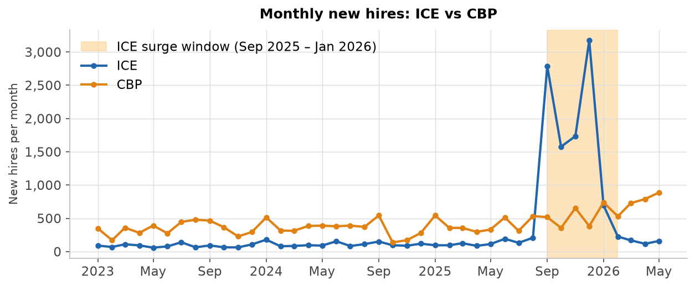
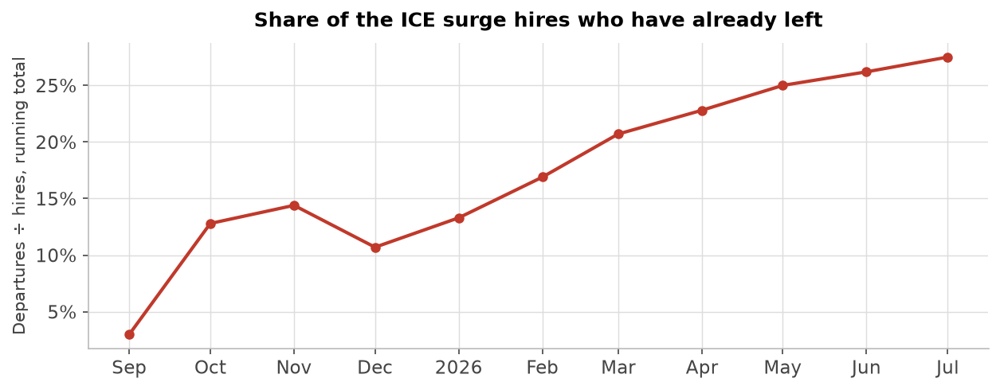

# ICE / CBP hiring-surge analysis (OPM EHRI)

Did the 2025 DHS hiring surge — especially at ICE and CBP — actually put officers on the payroll, and
are they staying? Built from OPM/EHRI records for hires, departures, and monthly headcount
(`impactproject/opm-ehri-data` on HuggingFace), read directly with DuckDB.

No findings or counts are written in this README. Every number lives in the notebooks (which compute it
from the data) and in `memo.md`; this file only says what the analysis does and how to rerun it.

## Deliverables
- **`dhs_hiring_surge.ipynb`** — the analysis, start to finish (charts + tables inline).
- **`memo.md`** — short memo; each figure is cross-referenced to a notebook section.
- **`attrition_screen.ipynb`** — follow-up: is ICE's rookie-attrition problem happening anywhere
  else? Checks FBI specifically, then screens every federal agency subelement using the same
  under-1-year-tenure signal. See its own intro cell for the method and caveats.

## Reproduce
```bash
pip install duckdb pandas matplotlib nbformat nbconvert jupyter huggingface_hub
python src/extract.py          # pull the ICE+CBP slice -> data/*.parquet
python src/history.py          # long-run hiring history + agency-code stability audit -> data/*.csv
python src/extract_screen.py   # FBI slice + government-wide under-1yr screen -> data/*.parquet
jupyter nbconvert --to notebook --execute --inplace dhs_hiring_surge.ipynb
jupyter nbconvert --to notebook --execute --inplace attrition_screen.ipynb
```
When OPM publishes a new month, refresh `data/hf_file_map.json`, rerun the extracts, then re-execute
the notebooks. The analysis windows and latest month are constants in `src/surge.py`.

## Layout
- `src/extract.py` — DuckDB query over the HuggingFace parquet; caches a small ICE+CBP extract to `data/`
  (hires, departures, headcount; the start months are set in the script).
- `src/history.py` — long-run ICE/CBP new-hire history and a reproducible agency-code stability audit
  (`data/ice_cbp_hires_history.csv`, `data/agency_code_audit.csv`).
- `src/surge.py` — shared constants: ICE=`HSBB`, CBP=`HSBD`, the surge-hire profile
  (GL pay plan + job series 1801/1811), and the analysis windows.
- `src/extract_screen.py` / `src/screen.py` — the FBI (job series 1811) slice and a government-wide,
  all-agency, under-1-year-tenure screen for `attrition_screen.ipynb`.
- `data/hf_file_map.json` — deduped max-version HuggingFace file list the extracts read from (committed;
  `src/extract.py` and `src/history.py` read it but don't regenerate it). `data/*.parquet` are the
  extracts themselves — git-ignored, rebuilt by the extract scripts.

## Method
The analysis rests on a handful of assumptions about the data. Each is tested against the raw files in
the notebook's **§0**, which prints the result; none of those results are repeated here.

- **Files add, they don't restate.** OPM's monthly files are incremental: each is mostly that month's
  actions plus a trickle of late-reported earlier ones. A clean per-month series therefore means summing
  across every file and grouping by when the action took effect, not by which file reported it. One file
  per month would undercount, most severely for the peak surge months.
- **Agency codes are stable and exclusive.** ICE = `HSBB`, CBP = `HSBD`. Lookalikes — USCIS (`HSAB`),
  DOJ immigration courts (`DJ12`) — are separate agencies and excluded. The code-stability audit is in
  `data/agency_code_audit.csv`.
- **Redaction hides values, not people.** A masked field (like work location) is relabeled, not dropped,
  so headcount and job totals still include everyone.
- **Surge hires are identified by job, not length of service.** The profile is pay plan `GL` + job
  series 1801/1811. Length of service mixes genuine new hires with rehires and veterans who arrive
  carrying prior federal credit, so it can't do this cleanly.
- **Departures attributed to the surge cohort are mostly the surge hires, not long-time job holders
  leaving at their normal pace.** There are no person IDs, so this can't be proven outright. The notebook
  bounds it by applying this job group's own pre-surge attrition rate to the group's size going into the
  surge, and stress-tests that rate at several multiples.
- **Headcount and flow don't fully reconcile.** For this job slice, headcount fell by more than hires
  minus departures explains. The notebook rules out promotion into GS-paid roles, a mass-transfer
  recoding, and reclassification to another pay plan, and checks that the decline is broad across age
  and grade. The mechanism for the remainder is unresolved. Headcount is used for levels and
  departures for exits; the two are never chained.
- **This job group's separations can land later than a typical month's.** The notebook measures what
  share of eventual departures appear in the event month's own file, by event month, and projects that
  lag onto recent thin months. That share varies by period, so read it from the notebook for the month
  you care about rather than assuming it is constant.
- **Deferred-resignation (DRP) exits.** The notebook checks the separations `drp_indicator` field for
  cohort departures, to rule out a buyout-program explanation.

## What the analysis covers
Read the notebook (and `memo.md`) for the numbers behind each of these.

1. **Scale and timing of the surge** (§1, §1b): ICE and CBP monthly and annual hiring against their own
   history, going back far enough to compare with earlier hiring pushes, and the share of hires that are
   genuine new hires rather than transfers.
2. **Whether it reached the payroll** (§2): monthly headcount for both agencies before, during, and
   after the surge.
3. **Who the surge hires are** (§3): job series, pay plan, grade, appointment type, and age, compared
   with normal ICE hiring.
4. **Who is leaving and how** (§4, §4b): departures from the surge job profile against its own hires,
   split voluntary vs. involuntary, and by series (enforcement/removal officers vs. criminal
   investigators). CBP's own entry classes, in normal years and in its earlier rapid-hire surge, serve as
   benchmarks, including a control on CBP's comparable jobs over the same window.
5. **Whether it is ICE-only** (`attrition_screen.ipynb`): FBI, then every agency subelement, using the
   same under-1-year-tenure signal. The screen also surfaces a separate pattern of civilian agencies
   with a hiring-freeze or downsizing signature.
6. **Caveats** (§5): counts not people; length of service is total federal service, not time in the job;
   involuntary exits can't be fully split between expired appointments and removals.



